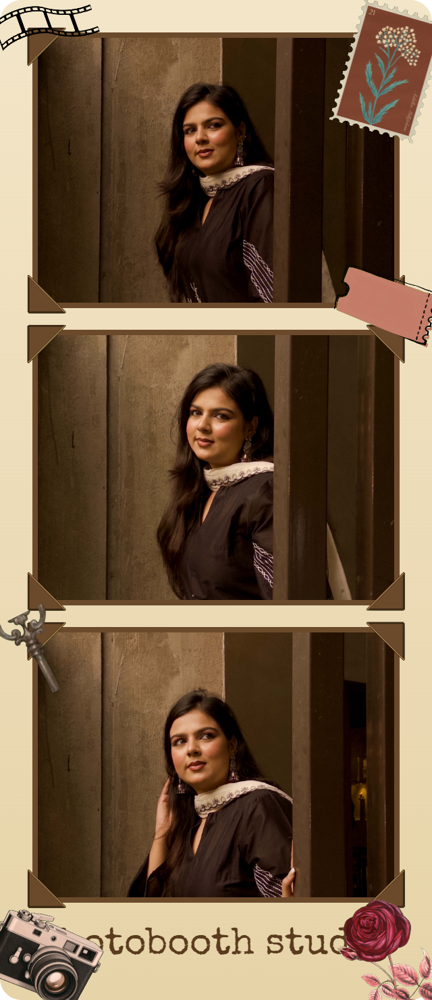
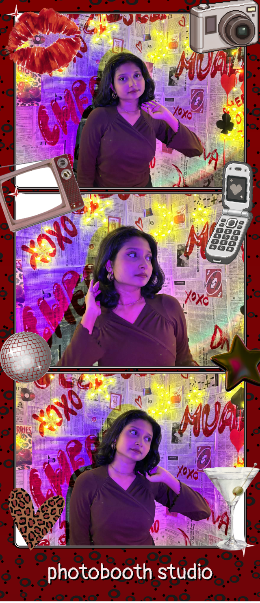
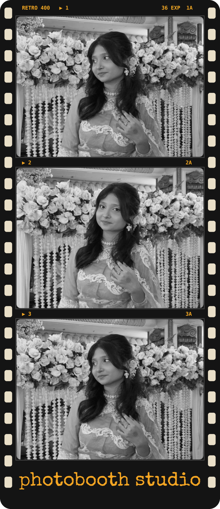
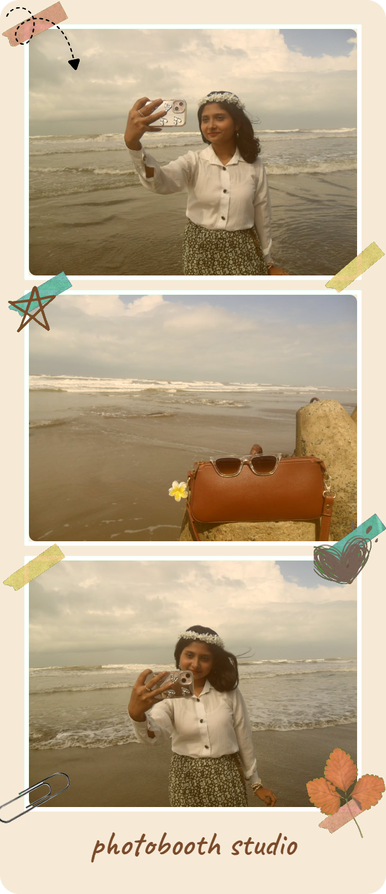

<div align="center">

# 📸 Photobooth Studio

### Snap it. Stick it. Keep it.

Take photos, pick your favorites, and turn them into a decorated photobooth strip, with stickers, tilted text, doodles and cute themes. No editing skills needed.

</div>

---

## ✨ What you can do

- 📷 **Live camera** with a 3-2-1 countdown and a shutter flash
- 🔁 **Auto strip** that keeps snapping until you have 8 photos (and a Stop button if you change your mind)
- 🖼️ **Pick your 3 favorites** from the tray and build your strip
- 🎀 **Stickers**: 7 hand-made ones, drag them anywhere, resize them, and **tilt them** so they sit on the corner of a photo
- ✍️ **Text in 5 fonts**: Bubble, Classic, Typewriter, Meme and Literature, with an angle control
- 🖍️ **Doodle** right on your strip, with undo and redo
- 🎞️ **Filters**: B&W, Vintage, Warm and Cool
- ✂️ **Cutout tool**: remove the background from a photo and use it as a sticker
- 📄 **A4 sticker sheet**: print your cutouts as a PNG or PDF, with cut lines
- ⬇️ **High-quality PNG download** of your finished strip

## 🎨 Themes

| | | |
|---|---|---|
| 🌸 **Cute** | 🎞️ **Vintage** | 💋 **Y2K** |
|  |  |  |
| 🎬 **Retro Film** | 📎 **Scrapbook** | ⚪ **Minimal** and **Classic** |
|  |  | clean and simple |

## 🚀 Run it on your computer

You need [Node.js](https://nodejs.org) and [Git](https://git-scm.com).

```bash
git clone https://github.com/sabihalabiba/photobooth.git
cd photobooth
npm install
npm run dev
```

Then open **http://localhost:3000** in Chrome and allow the camera.

> 💡 The camera only works on `localhost` or on an HTTPS site, so a plain Wi-Fi address on your phone won't open it.

## 🛠️ Built with

| Tool | What it does here |
|---|---|
| **Next.js** and **React** | pages, routing and the dev server |
| **TypeScript** | catches mistakes early |
| **Tailwind CSS** | all the styling |
| **Zustand** | the shared memory for photos, stickers, text and themes |
| **HTML Canvas** | draws the downloaded strip and the A4 sheet |
| **Camera API** | the live camera |
| **jsPDF** | the sticker sheet PDF |
| **Lucide** | icons |

## 🗂️ How the project is organised

```
app/          pages: home, camera, editor, sheet
components/   camera, photo tray, strip preview, editor toolbar, cutout tool
lib/          store, themes, fonts, stickers, strip and sheet export
public/       stickers, theme frames and example strips
```

**How a photo travels:** camera → tray → editor → download. Every screen reads the same data from one shared store, which is why the preview always matches the PNG you download.

## 🗺️ What's next

- [ ] Go live on Vercel
- [ ] Polaroid and square formats
- [ ] More themes and sticker packs
- [ ] Save your strips with a login

## 💌 Made by

**Labiba** (design, themes, stickers and the front end) and **Toshrif** (camera, filters, export and the cutout tool).

<div align="center">

*Tiny moments, big smiles.* 🎀

</div>